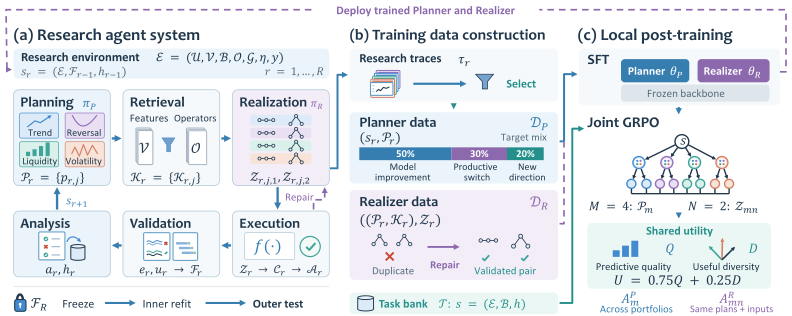

<div align="center">

<h1>AlphaDiverse</h1>
<p><strong>Post-Training Local Quantitative Research Agents<br>for Diverse Exploration in Alpha Factor Mining</strong></p>
<p>让量化研究智能体持续探索互补的经济机制</p>

<p>
  <a href="https://github.com/FTShare-Lab/AlphaDiverse"></a>
  <a href="https://arxiv.org/abs/2609.29014"></a>
  <a href="https://arxiv.org/pdf/2609.29014"></a>
  <a href="#quick-start"></a>
</p>

<p><strong>简体中文</strong> · <a href="README_EN.md">English</a></p>
<p><a href="#overview">框架总览</a> · <a href="#quick-start">快速开始</a> · <a href="#data">数据准备</a> · <a href="#evaluation">评估与结果</a> · <a href="#citation">引用</a></p>

</div>

**AlphaDiverse** 是一个面向 Alpha 因子挖掘的多智能体研究框架。它将经济机制规划、特征与算子检索、结构化因子实现和评估反馈组织为闭环，让每一轮研究基于已有证据探索新的因子方向。

> **本仓库提供论文第 2.1 节 Research Agent System 的 agent loop 实现**，可在个人服务器上接入兼容的模型接口运行。论文中的后训练模型后续将以 **API** 形式提供，接入信息将在本页更新。

<a id="overview"></a>

## 框架总览

<p align="center">
  <a href="assets/overview.svg"></a>
</p>

### 从研究计划到可验证因子

| 环节                  | 作用                                                   |
| :-------------------- | :----------------------------------------------------- |
| **Planning**    | 从可行的经济机制中提出四个互补计划，覆盖至少三个主题。 |
| **Retrieval**   | 为每个计划确定性检索匹配的特征与算子，明确实现边界。   |
| **Realization** | 将每个计划转为两个结构化因子规格，形成每轮八个候选。   |
| **Execution**   | 校验 JSON 合约，通过受控算子计算因子。                 |
| **Validation**  | 先筛选因子，再评估新增因子对预测模型的增益。           |
| **Analysis**    | 汇总本轮证据，更新研究记忆并指导下一轮探索。           |

- **机制驱动的探索**：显式研究计划与互补约束帮助组织多轮搜索。
- **可执行、可追踪**：保存因子规格、筛选决策与反馈，连接研究意图和数值结果。
- **独立的最终评估**：循环仅使用 inner 数据；冻结因子和模型后，在 outer 区间评估一次。

<a id="quick-start"></a>

## 快速开始

需要 **Python 3.10+**、本地 Parquet 特征面板，以及支持结构化 JSON 输出的 `/chat/completions` 模型接口。因子研究与模型评估可在 CPU 上运行；模型推理由所连接的服务提供。

### 1. 安装

在仓库根目录执行：

```bash
python3 -m venv .venv
source .venv/bin/activate
python -m pip install -r requirements.txt
```

### 2. 配置模型

可使用托管 API，也可连接自行部署的兼容接口。

```bash
export ALPHADIVERSE_BASE_URL="https://your-provider.example/v1"
export ALPHADIVERSE_MODEL="your-model-id"
read -r -s -p "API key: " ALPHADIVERSE_API_KEY
export ALPHADIVERSE_API_KEY
```

Planner、Realizer 和 Analysis 默认共用上述模型。使用本地推理服务时，设置 `ALPHADIVERSE_BACKEND=local`；无需认证的本地接口可省略密钥。

<details>
<summary><strong>按角色配置与生成参数</strong></summary>

使用 `ALPHADIVERSE_PLANNER_`、`ALPHADIVERSE_REALIZER_` 或 `ALPHADIVERSE_ANALYSIS_` 前缀覆盖对应角色的设置，例如 `ALPHADIVERSE_PLANNER_MODEL` 和 `ALPHADIVERSE_REALIZER_BASE_URL`。

| 环境变量后缀         | 默认值     | 说明                                         |
| :------------------- | :--------- | :------------------------------------------- |
| `BACKEND`          | `api`    | `api` 或 `local`                         |
| `CONTEXT_TOKENS`   | `131072` | 按模型实际上下文上限设置                     |
| `MAX_TOKENS`       | `8192`   | 初始输出预算，截断时可在上下文范围内有限重试 |
| `TIMEOUT_SECONDS`  | `300`    | 单次请求读取超时，单位为秒                   |
| `TEMPERATURE`      | `0.1`    | 采样温度                                     |
| `THINKING`         | 未设置     | 接口支持时使用`0` / `1`                  |
| `REASONING_EFFORT` | 未设置     | 使用接口支持的推理强度取值                   |

</details>

### 3. 启动研究

按照[数据接口](docs/data.md)准备特征面板后运行：

```bash
python -m alphadiverse \
  --data data/base_panel \
  --membership-data data/daily_weights \
  --market hs300 \
  --base level1 \
  --folds 1 \
  --rounds 20 \
  --output results/hs300_run
```

**默认设置：HS300 · Level1 · 1 fold · 20 轮 · feature mask 70%。** 如果特征面板已包含完整的逐日历史成分标记，可省略 `--membership-data`。`bash run.sh` 与 `python -m alphadiverse` 等价；每次运行使用新的输出目录。

<details>
<summary><strong>市场、时间区间与研究设置</strong></summary>

| 参数                                | 默认值                          | 可选设置                                       |
| :---------------------------------- | :------------------------------ | :--------------------------------------------- |
| `--market`                        | `hs300`                       | `ashare`、`hs300`、`csi500`、`csi1000` |
| `--base`                          | `level1`                      | `level1`、`alpha20`                        |
| `--folds`                         | `1`                           | 设为 n 可运行n折研究                          |
| `--rounds`                        | `20`                          | 研究轮数                                       |
| `--feature-mask`                  | `70`                           | 屏蔽可选研究特征的百分比，保留基础输入         |
| `--threads`                       | `4`                           | 本地计算线程数                                 |
| `--inner-start` / `--inner-end` | `2022-05-01` / `2025-12-31` | inner 研究区间                                |
| `--outer-start` / `--outer-end` | `2026-01-01` / `2026-08-31` | 最终留出评估区间                               |

时间区间需要覆盖足够的交易日，以支持训练、验证与研究切分。基础因子也可通过 `--base-features` 显式指定，详见[数据接口](docs/data.md)。

</details>

<a id="data"></a>

## 数据准备

系统读取本地预计算的股票—日期特征面板，支持单个 Parquet 文件或互不重叠的 Parquet 分区。每个 `date`—`symbol` 对应一条记录。

| 输入       | 内容                                                                                   |
| :--------- | :------------------------------------------------------------------------------------- |
| 标识与行情 | `date`、`symbol`、`open`、`high`、`low`、`close`、`volume`、`turnover` |
| 研究特征   | 基础因子，以及可用的日频 / 分钟频量价特征                                              |
| 收益标签   | `label_<market>_excess_ret_1d`                                                       |
| 历史股票池 | `in_<market>`，或通过 `--membership-data` 提供逐日历史成分                         |

信号日 **t** 的特征使用截至当日收盘的信息，预测目标为 **open(t+1) → open(t+2)** 的市场超额收益。使用逐日历史成分，并在数据准备阶段完成可交易股票筛选。

完整字段、Level1 / Alpha20 基础因子、滚动窗口预热与成分表格式见 **[数据接口文档](docs/data.md)**。

<a id="evaluation"></a>

## 评估与结果

循环使用 inner 时间折进行因子筛选和模型选择；Ridge 与 LightGBM 在相同切分下评估。新增因子通过筛选且提升模型综合分时，才进入保留集合。研究结束后冻结因子集合与模型选择，使用 inner 数据完成最终拟合，再执行 outer 评估。

<details>
<summary><strong>综合分与时间切分</strong></summary>

Inner 按时间顺序划分为指定折数，每折使用 **70% 训练 / 10% 验证 / 20% 研究评估**，并清除标签区间跨界的样本。保留新因子要求交易日加权综合分提高，且严格多数对应折改善。

综合分为以下五项归一化指标的均值：

| 指标       | RankIC | RankICIR |  IC  | ICIR | 多空年化收益 |
| :--------- | :----: | :------: | :--: | :--: | :----------: |
| 归一化尺度 |  0.05  |   0.35   | 0.03 | 0.25 |     0.30     |

ICIR / RankICIR 为日度相关系数均值除以日度标准差，Sharpe 按年化口径计算。收益均为费前研究口径。

</details>

```text
results/hs300_run/
├── run.json             # 运行配置与状态
├── rounds/              # 每轮计划、因子、决策与反馈
├── factors.json         # 因子规格与 accepted / retained 标记
├── summary.json         # 完成摘要与最终保留因子
├── metrics.csv          # Baseline / final 的 outer 指标
├── daily_ic.csv         # 逐日 IC 与 RankIC
├── returns.csv          # 评分口径的逐日组合收益
├── final_groups.csv     # 最终模型十组收益
├── final_returns.csv    # 最终模型 top10%−bottom10% 收益
└── equity.png           # 最终模型四子图
```

`equity.png` 展示最终模型的 **十组净值、top10%−bottom10% 净值、回撤及最大回撤、20 日滚动 RankIC**。若运行中断，`status.json` 记录失败阶段，已完成轮次保留。

## 代码导航

| 模块                                                        | 内容                                 |
| :---------------------------------------------------------- | :----------------------------------- |
| [`alphadiverse/agent/`](alphadiverse/agent/)               | 研究规划、检索、实现、验证与反馈闭环 |
| [`alphadiverse/operators/`](alphadiverse/operators/)       | 因子算子注册、规格校验与执行         |
| [`alphadiverse/factors/`](alphadiverse/factors/)           | 量价特征与基础因子定义               |
| [`alphadiverse/model_eval.py`](alphadiverse/model_eval.py) | 时间折选模与最终留出评估             |
| [`alphadiverse/config.py`](alphadiverse/config.py)         | 默认研究与评估设置                   |

<a id="citation"></a>

## 引用

如果本项目对你的研究有帮助，欢迎引用[论文](https://arxiv.org/abs/2609.29014)：

```bibtex
@article{wang2026alphadiverse,
  title   = {AlphaDiverse: Post-Training Local Quantitative Research Agents for Diverse Exploration in Alpha Factor Mining},
  author  = {Wang, Qingzhuo and Wei, Zikun and Wei, Zhihua and Shen, Wen},
  journal = {arXiv preprint arXiv:2609.29014},
  year    = {2026},
  url     = {https://arxiv.org/abs/2609.29014}
}
```
